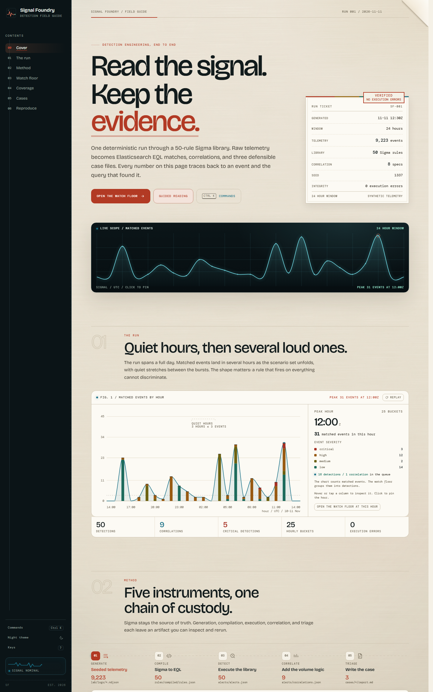
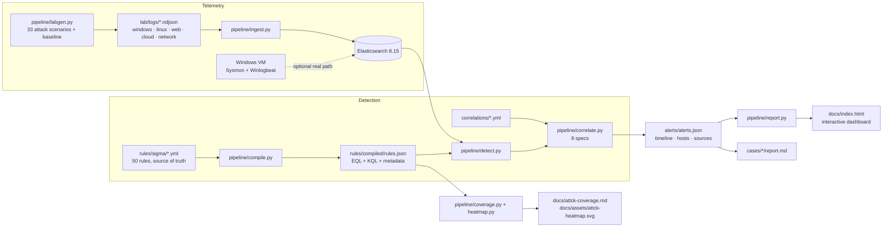
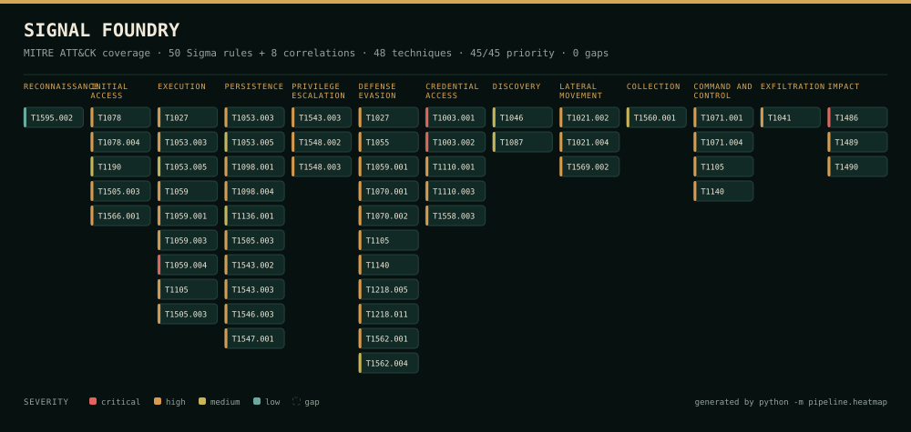
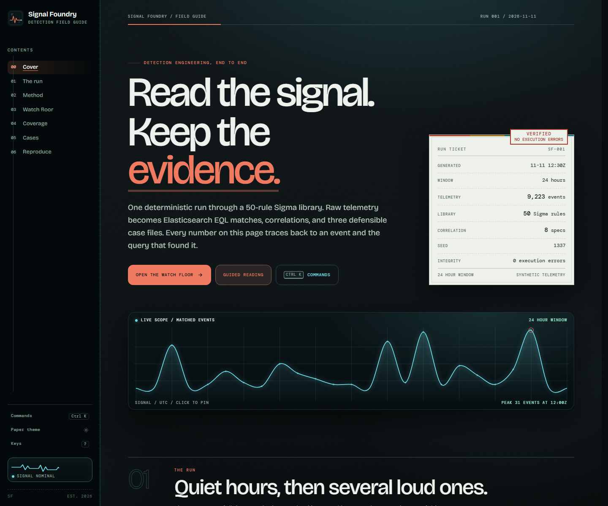

# Signal Foundry

**Detection engineering, from raw telemetry to defensible alerts.**

[](pyproject.toml)
[](docker-compose.yml)
[](rules/sigma)
[](tests)
[](docs/attck-coverage.md)
[](LICENSE)
[](.github/workflows/ci.yml)



Signal Foundry is a detection lab you can rerun. It generates 9,223 synthetic events, compiles 50 Sigma rules to Elasticsearch EQL and KQL, runs them against a local Elasticsearch stack, correlates the matches, and turns the result into an interactive dashboard and three analyst case reports. Every number in the dashboard traces to an event and the query that found it.

| What you can inspect | Where |
|---|---|
| Sigma as the source of truth, compiled to EQL and KQL | [`rules/sigma/`](rules/sigma), [`pipeline/compile.py`](pipeline/compile.py) |
| SIEM operations on Elasticsearch and Kibana | [`docker-compose.yml`](docker-compose.yml), [`config/`](config) |
| Threshold and distinct-value correlation, tested without a SIEM | [`correlations/`](correlations), [`pipeline/correlate.py`](pipeline/correlate.py) |
| Analyst-quality incident write-ups | [`cases/`](cases) |
| ATT&CK coverage with an explicit gap view | [`docs/attck-coverage.md`](docs/attck-coverage.md) |
| Detection tuning with recorded false positives | [`docs/tuning.md`](docs/tuning.md) |
| Tests and CI that treat rules like software | [`tests/`](tests), [`.github/workflows/ci.yml`](.github/workflows/ci.yml) |
| A dashboard a reviewer can click through | [`docs/index.html`](docs/index.html) |

---

## At a glance

| | |
|---|---|
| **Detections** | 50 Sigma rules and 8 correlation specs |
| **Telemetry** | 9,223 deterministic events across Windows, Linux, web, AWS, and network flows |
| **Scenarios** | 33 attack scenarios plus a benign baseline, spread across a 24-hour window |
| **Coverage** | 48 ATT&CK techniques, 13 tactics, 45 of 45 priority techniques, 0 gaps |
| **Correlation** | Sliding windows with optional distinct-value thresholds, for example 10 attempts across 8 accounts |
| **Backend** | Elasticsearch 8.15.3 and Kibana 8.15.3, single node, security disabled for lab use |
| **Tests** | 44 passing: lint, compilation, correlation, lab generation, coverage, dashboard assembly |
| **Frontend** | One self-contained HTML file with no build step, CDN, or network request |

---

## How it works



The repo has two ingestion paths on purpose:

* **Synthetic.** `pipeline/labgen.py` emits deterministic ECS-shaped events from named attack scenarios. It needs no VM, works in CI, and reproduces every number in this README.
* **Real.** Point a Windows VM running Sysmon and Winlogbeat at the same Elasticsearch with [`config/winlogbeat.yml`](config/winlogbeat.yml), then switch [`config/logsource_map.yml`](config/logsource_map.yml) to the `logs-windows.*` data streams.

> All telemetry in this repo is synthetic lab data and is labelled as such. It models attacker behaviour. It is not a production baseline.

---

## Quickstart

### Requirements

* Python 3.11, 3.12, or 3.13. pySigma does not support 3.14 yet.
* Docker Desktop with Compose v2.
* About 4 GB of free RAM for Elasticsearch and Kibana.

### 1. Create the Python environment

Windows PowerShell:

```powershell
py -3.11 -m venv .venv
.\.venv\Scripts\Activate.ps1
python -m pip install -r requirements.txt
```

macOS or Linux:

```bash
python3.11 -m venv .venv
source .venv/bin/activate
python -m pip install -r requirements.txt
```

The Python pipeline is cross-platform. The helper scripts in [`scripts/`](scripts) are PowerShell.

### 2. Start Elasticsearch and Kibana

```powershell
docker compose up -d
```

Kibana is at `http://localhost:5601`. Security and TLS are disabled on purpose. Keep the stack on localhost.

### 3. Generate and index the snapshot

```powershell
python -m pipeline.labgen --scenario all --base-time 2026-11-11T12:30:00Z
python -m pipeline.ingest --reset
```

The `--base-time` value matches the committed dashboard. Omit it for a run against the current clock. The event count stays at 9,223, but the timestamps move.

### 4. Compile and run the detections

```powershell
python -m pipeline.compile
python -m pipeline.detect --hours 24 --end 2026-11-11T12:30:00Z
```

This writes `alerts/summary.md` and `alerts/alerts.json`. Omit `--end` for a live run against current telemetry.

### 5. Build the dashboard

```powershell
python -m pipeline.report --open
```

`docs/index.html` is the result. It works from `file://`, from a static server, and on GitHub Pages.

### Run without Docker

These steps cover everything except the live Elasticsearch path:

```powershell
python -m pytest
python -m pipeline.lint
python -m pipeline.compile
python -m pipeline.coverage
python -m pipeline.heatmap
python -m pipeline.labgen --scenario all
python -m pipeline.correlate --input lab/logs/linux.ndjson
```

[`scripts/demo.ps1`](scripts/demo.ps1) runs the same Docker-free sequence on Windows. `pipeline.report` is not part of this path because it needs `alerts/alerts.json`, and only `pipeline.detect` writes that file.

---

## Commands

| Command | What it does |
|---|---|
| `python -m pipeline.labgen --scenario all` | Writes deterministic NDJSON telemetry to `lab/logs/` |
| `python -m pipeline.ingest --reset` | Deletes `lab-*` indices and indexes the NDJSON files |
| `python -m pipeline.compile` | Compiles Sigma to EQL and KQL under `rules/compiled/` |
| `python -m pipeline.detect --hours 24` | Runs every rule and correlation, writes `alerts/` |
| `python -m pipeline.detect --dry-run` | Prints the queries without running them |
| `python -m pipeline.correlate --input FILE` | Runs correlation over an exported NDJSON file |
| `python -m pipeline.report --open` | Builds and opens `docs/index.html` |
| `python -m pipeline.coverage` | Regenerates `docs/attck-coverage.md` |
| `python -m pipeline.heatmap` | Regenerates `docs/assets/attck-heatmap.svg` |
| `python -m pipeline.lint` | Fails on missing rule metadata or ATT&CK tags |
| `python -m pytest` | Runs the test suite |

Use `--check` with `pipeline.compile` or `pipeline.coverage` to fail when the committed artifact is stale. CI uses both flags.

---

## Detection library

50 Sigma rules: 34 high, 8 medium, 5 critical, and 3 low. Every rule carries `description`, `references`, `falsepositives`, `level`, and ATT&CK tags. [`pipeline/lint.py`](pipeline/lint.py) enforces that metadata, so a rule without tuning notes or a technique mapping fails CI.

| Source | Rules | Examples |
|---|---|---|
| Windows (Sysmon, Security, System) | 30 | LSASS access, encoded PowerShell, remote thread creation, ADMIN$ access, service install, registry Run key |
| Linux (auth, audit, cron) | 10 | reverse shell, valid-account login, root SSH, SSH key modification, sudoers change, systemd unit |
| Web (nginx) | 7 | PHP upload, web shell parameter, C2 beacon, command injection, SQL injection, path traversal, scanner user agent |
| Cloud (AWS CloudTrail) | 2 | access key creation, root console login |
| Network (flow) | 1 | large outbound transfer |

### Correlation library

Sigma aggregation support varies by backend, so the base rules stay single-event and portable. [`pipeline/correlate.py`](pipeline/correlate.py) applies sliding-window logic and is unit-testable without a SIEM.

| Spec | Logic | Technique |
|---|---|---|
| `corr-ssh-bruteforce` | 8 failures / 5 min / source IP | T1110.001 |
| `corr-password-spray` | 10 failures across 8 distinct accounts / 10 min | T1110.003 |
| `corr-port-scan` | 20 inbound flows / 1 min / source IP | T1046 |
| `corr-discovery-burst` | 4 discovery commands / 5 min / host | T1087 |
| `corr-ransomware-file-burst` | 15 file writes / 2 min / host | T1486 |
| `corr-web-scan` | 20 requests / 1 min / source IP | T1595.002 |
| `corr-web-shell-burst` | 5 web shell requests / 2 min / source IP | T1505.003 |
| `corr-dns-tunnel` | 12 DNS queries / 2 min / host | T1071.004 |

---

## Case reports

| Case | Scenario | Verdict |
|---|---|---|
| [001: SSH brute force](cases/case-001-ssh-bruteforce/report.md) | 14 failures, then a success from `203.0.113.44` | True positive, successful unauthorized access |
| [002: Multi-stage intrusion](cases/case-002-multi-stage-intrusion/report.md) | Macro, encoded PowerShell, certutil, LSASS, persistence | True positive, credential theft and persistence |
| [003: Ransomware sequence](cases/case-003-ransomware/report.md) | Recovery deletion, service stops, notes, 24 encrypted files | True positive, contained before the share was lost |

Each report follows the same structure: summary, timeline, evidence, analysis, ATT&CK mapping, verdict, containment, detection improvements, and reproduction steps.

---

## ATT&CK coverage



The matrix is generated from compiled rules and correlations, not hand-maintained. Covered tiles name the rule that closes them. Dashed tiles are the next rules to write, not omissions hidden inside a percentage. The full report is in [`docs/attck-coverage.md`](docs/attck-coverage.md).

Representative coverage:

| Technique | Name | Detection |
|---|---|---|
| T1003.001 | LSASS Memory | LSASS Process Access |
| T1059.001 | PowerShell | PowerShell Encoded Command Execution |
| T1486 | Data Encrypted for Impact | Ransomware Note and File Burst |
| T1490 | Inhibit System Recovery | Shadow Copy Deletion and BCDEdit Recovery Disabled |
| T1021.004 | SSH | Root SSH Login from an External Address |
| T1071.001 | Web Protocols | Periodic Web Beacon to a Command Endpoint |

---

## The dashboard

[`docs/index.html`](docs/index.html) is generated by [`pipeline/report.py`](pipeline/report.py) and is completely self-contained. It works offline, from `file://`, and on GitHub Pages.

* A live scope on the cover that scans the same hourly run as the chart, with pings where volume crosses the peak threshold; click it to pin that hour on the chart
* Auto-replaying hourly signal chart with a smoothed envelope, quiet-baseline markers, event severity, and an event-versus-detection split
* Watch floor with a fixed evidence inspector, host lanes, severity chips, host filter, sort, and free-text search (`/` focuses it)
* Separate tab for correlation alerts, including threshold, window, and distinct-account counts
* Expand any detection to see the raw evidence events and the exact EQL and KQL that fired
* Clickable ATT&CK matrix that filters the watch floor by technique, with hover cards naming the detection that covers each tile, plus a gaps-only view
* Inspector timing bars showing when each detection was first and last seen in the window
* EQL and KQL panels with syntax highlighting and one-click copy
* Case cards with a detection chain that opens a case-file summary and links to the published investigation reports
* A case-chain player that steps through each investigation's detections in order, with the rule, time, host, and EQL for every step
* A host-lane hour axis and a severity-mix bar in the watch floor status band
* Paper and night themes, a command palette (`Ctrl/Cmd K`), a guided nine-step reading, keyboard shortcuts, and reduced-motion support
* Copy buttons for every command and query

The source is split for maintenance: [`dashboard/template.html`](dashboard/template.html), [`dashboard/styles.css`](dashboard/styles.css), [`dashboard/app.js`](dashboard/app.js), [`dashboard/icon.svg`](dashboard/icon.svg), and the locally embedded WOFF2 files in [`dashboard/fonts/`](dashboard/fonts). The report step inlines the source and the fonts into one HTML file.

The design system, motion rules, contrast evidence, and accessibility contract are in [`docs/design.md`](docs/design.md).

Chrome Lighthouse against the built page reports **100 accessibility, 100 best practices, and 100 SEO**. Performance is not part of that audit, so this repo does not publish a performance score.

<p align="center">
  
</p>

---

## Use real telemetry

1. Install Sysmon on the Windows VM with the SwiftOnSecurity or Olaf Hartong configuration.
2. Copy [`config/winlogbeat.yml`](config/winlogbeat.yml) and set `output.elasticsearch.hosts` to the lab machine's LAN address.
3. Run `.\install-service-winlogbeat.ps1`, then `Start-Service winlogbeat`.
4. In [`config/logsource_map.yml`](config/logsource_map.yml), point `windows` at `logs-windows.sysmon_operational-*`, `logs-windows.security-*`, and `logs-windows.system-*`.
5. For Linux, ship `auth.log` and audit logs with Filebeat or Elastic Agent, then point the `linux` entry at those data streams.
6. Recompile and rerun: `python -m pipeline.compile`, then `python -m pipeline.detect`.

Verify the fields your rules depend on before trusting a "no alerts" result:

```powershell
curl.exe "http://localhost:9200/logs-windows.sysmon_operational-*/_mapping" | Select-String "executable.caseless"
```

The `.caseless` fields come from the Winlogbeat processors. Without them, rules that match process paths case-insensitively will silently never fire.

---

## Tests and CI

```powershell
python -m pytest -q
```

The 44 tests cover rule metadata, Sigma compilation, correlation windows and distinct counts, telemetry generation, coverage accounting, and dashboard assembly.

[`.github/workflows/ci.yml`](.github/workflows/ci.yml) runs on every push and pull request:

1. `python -m pipeline.lint`
2. `python -m pipeline.compile` and `python -m pipeline.compile --check`
3. `python -m pipeline.coverage` and `python -m pipeline.coverage --check`
4. `python -m pipeline.heatmap`, then a `git diff --exit-code` check on the SVG
5. `python -m pytest`
6. `python -m pipeline.labgen --scenario all` as a smoke test

Generated artifacts are committed so reviewers can read them without running anything. CI fails when they drift.

---

## Troubleshooting

| Symptom | Cause | Fix |
|---|---|---|
| `PUT _index_template` returns 400 `can't merge a non object mapping` | Elasticsearch treats dots in field names as object paths, so `process.executable` and `process.executable.caseless` collide | `"subobjects": false` on `process` and `process.parent`, already set in [`config/index-template.json`](config/index-template.json) |
| `DELETE lab-*` returns 400 `Wildcard expressions or all indices are not allowed` | Elasticsearch 8 sets `action.destructive_requires_name` | Delete named indices. `pipeline/ingest.py` does this for you |
| Detections report `Unknown index [lab-windows]` | Ingestion never created the index, so every EQL search fails | Fix ingestion first and confirm with `GET _cat/indices/lab-*` |
| `0 rule matches` but events are indexed | Field mapping mismatch, most often a missing `.caseless` field | Run `GET lab-*/_mapping` and compare with [`config/index-template.json`](config/index-template.json) |
| `pipeline.report` says `alerts/alerts.json` is missing | The detection run has not produced output yet | Run `python -m pipeline.detect` first |
| Kibana is not reachable yet | It waits for Elasticsearch health | Run `docker compose ps`, then retry after about 30 seconds |

---

## Limitations

* Single-node Elasticsearch with security disabled. This is a lab, not a production deployment.
* Synthetic telemetry covers the detections in this repo. It does not model an enterprise baseline, so precision figures are illustrative, not production measurements.
* Correlation runs in-process over a bounded event fetch of 10,000 events. That is fine for the lab and wrong at production scale.
* All 45 priority techniques are covered in this lab. The gaps view remains as a regression check. Production precision still depends on real telemetry and tuning.
* The dashboard is a static snapshot of one run. It is not a live SIEM view.
* There is no memory or API telemetry beyond LSASS handle access, so process injection and in-memory credential theft remain partly blind.

---

## Repository layout

```text
rules/sigma/            Sigma rules (source of truth)
rules/compiled/         Generated EQL/KQL and metadata (committed for review)
correlations/           Threshold and distinct-value correlation specs
pipeline/               compile, lint, coverage, labgen, ingest, detect, correlate, report, heatmap
dashboard/              Dashboard source: template, styles, script, icon, fonts
config/                 Elasticsearch template, Filebeat, Winlogbeat, index routing
lab/logs/               Generated telemetry (gitignored)
alerts/                 Detection output (gitignored)
cases/                  Analyst case reports and dashboard metadata
docs/                   Dashboard, design system, runbook, tuning log, ATT&CK coverage
tests/                  pytest suite
scripts/                Convenience scripts
```

---

## Publish the dashboard

[`.github/workflows/pages.yml`](.github/workflows/pages.yml) publishes `docs/` on every push to `main`.

1. Push the repository to GitHub.
2. Open **Settings → Pages** and set **Source** to **GitHub Actions**.
3. Push to `main` or run the workflow manually. GitHub shows the published URL in the workflow run and in **Settings → Pages**.

The dashboard has no server-side dependencies, so Pages serves it as-is. If you fork the repo under a different name, the workflow still publishes `docs/`; no code change is needed.

---

## Roadmap

- [ ] Add false-positive tests for every rule
- [ ] Add Kibana saved objects so detections and the dashboard deploy as code
- [ ] Wire `pipeline/detect.py` into a webhook notifier for a simulated on-call flow
- [ ] Add a Zeek or PCAP source and a beaconing detection with jitter analysis
- [ ] Publish a write-up of case 003

---

## Contributing and security

Read [`CONTRIBUTING.md`](CONTRIBUTING.md) before changing a rule or the pipeline. Report vulnerabilities through GitHub's private reporting flow described in [`SECURITY.md`](SECURITY.md). Do not open a public issue for a security problem, and do not submit real logs, credentials, or personal data.

## License

[MIT](LICENSE). Use the rules and pipeline freely. Attribution is appreciated.
