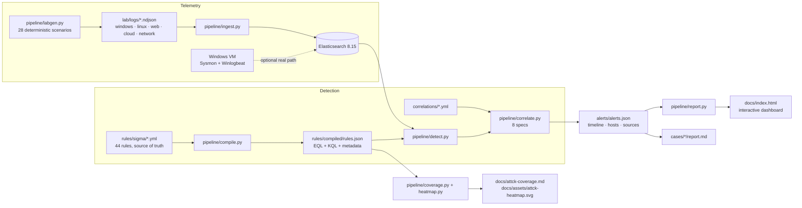

# Signal Foundry

**Detection engineering, from raw telemetry to defensible alerts.**

[](pyproject.toml)
[](docker-compose.yml)
[](rules/sigma)
[](tests)
[](docs/attck-coverage.md)
[](LICENSE)
[](https://github.com/YOUR-USERNAME/signal-foundry/actions/workflows/ci.yml)

> Replace `YOUR-USERNAME` with your GitHub handle after the first push. See [Publishing](#publishing).


<p align="center">
  <a href="https://YOUR-USERNAME.github.io/signal-foundry/"><b>Open the interactive dashboard</b></a>
  &nbsp;·&nbsp;
  <a href="cases/case-003-ransomware/report.md">Read case 003</a>
  &nbsp;·&nbsp;
  <a href="docs/attck-coverage.md">ATT&CK coverage</a>
</p>

---

## Why this exists

Most portfolio projects stop at "I wrote some rules." A detection engineer owns the whole loop: collect telemetry, write and tune detections, investigate what fires, decide true or false positive, document the incident, and measure what is still blind.

Signal Foundry is that loop, made reproducible. Every alert, chart, and case in this repo regenerates on a fresh machine from one seeded scenario generator. No screenshots of someone else's SIEM. No unverifiable claims.

| What a reviewer can check | Where |
|---|---|
| Sigma as the source of truth, compiled to EQL and KQL | [`rules/sigma/`](rules/sigma), [`pipeline/compile.py`](pipeline/compile.py) |
| SIEM operations on a real Elasticsearch and Kibana stack | [`docker-compose.yml`](docker-compose.yml), [`config/`](config) |
| Threshold and distinct-value correlation, tested without a SIEM | [`correlations/`](correlations), [`pipeline/correlate.py`](pipeline/correlate.py) |
| Analyst-quality incident write-ups | [`cases/`](cases) |
| ATT&CK coverage with honest gap analysis | [`docs/attck-coverage.md`](docs/attck-coverage.md) |
| Detection tuning with recorded false positives | [`docs/tuning.md`](docs/tuning.md) |
| Tests and CI that treat rules like software | [`tests/`](tests), [`.github/workflows/ci.yml`](.github/workflows/ci.yml) |
| A dashboard a hiring manager can click through | [`docs/index.html`](docs/index.html) |

---

## At a glance

| | |
|---|---|
| **Detections** | 44 Sigma rules + 8 correlation specs |
| **Telemetry** | 2,182 deterministic events across Windows, Linux, web, AWS, and network flows |
| **Scenarios** | 28 named attack scenarios plus a benign baseline |
| **Coverage** | 42 ATT&CK techniques, 13 tactics, 39 of 45 priority techniques, 6 gaps documented |
| **Correlation** | Sliding windows with optional distinct-value thresholds, for example 10 attempts across 8 accounts |
| **Backend** | Elasticsearch 8.15.3 + Kibana 8.15.3, single node, security disabled for lab use |
| **Tests** | 40 passing: lint, compilation, correlation, lab generation, coverage, dashboard assembly |
| **Frontend** | One self-contained HTML file, no build step, no CDN, no network |

---

## Architecture



Two ingestion paths exist on purpose:

* **Synthetic:** `pipeline/labgen.py` emits deterministic ECS-shaped events from named attack scenarios. CI-friendly, no VM required, and every result in this README is reproducible.
* **Real:** point a Windows VM running Sysmon at the same Elasticsearch with [`config/winlogbeat.yml`](config/winlogbeat.yml), then switch [`config/logsource_map.yml`](config/logsource_map.yml) to the `logs-windows.*` data streams.

> All telemetry committed or shown here is **synthetic lab data**, clearly labelled as such. It models attacker behaviour. It is not a production baseline.

---

## The dashboard

[`docs/index.html`](docs/index.html) is generated by `pipeline/report.py` and is completely self-contained. It works offline, from `file://`, and on GitHub Pages.

* Auto-replaying hourly signal chart with quiet-baseline markers, event severity, and an event-versus-detection split
* Detection ledger with severity chips, host filter, sort, and free-text search (`/` focuses it)
* Separate tab for correlation alerts, including threshold, window, and distinct-account counts
* Expand any detection to see the raw evidence events and the exact EQL and KQL that fired
* Clickable ATT&CK matrix that filters the ledger by technique, plus a gaps-only view
* Case cards that open a case-file summary and link to the published investigation reports
* Paper and night themes, a command palette (`Ctrl/Cmd K`), a guided seven-step tour, keyboard shortcuts, and reduced-motion support
* Copy buttons for every command and query

Regenerate it at any time:

```powershell
.\.venv\Scripts\python.exe -m pipeline.report --open
```

The committed dashboard anchors the detection window so the published numbers do not drift as the clock moves:

```powershell
.\.venv\Scripts\python.exe -m pipeline.detect --hours 24 --end "2026-11-11T12:30:00Z"
```

Omit `--end` for a live run against current telemetry.

The source is split for maintenance: [`dashboard/template.html`](dashboard/template.html), [`dashboard/styles.css`](dashboard/styles.css), [`dashboard/app.js`](dashboard/app.js), and [`dashboard/icon.svg`](dashboard/icon.svg), with locally embedded WOFF2 files in [`dashboard/fonts/`](dashboard/fonts). The report step inlines the source and the fonts into one HTML file.

---

## ATT&CK coverage


The matrix is generated from compiled rules plus correlations, not hand-maintained. Covered tiles name the rule that closes them. Dashed tiles are the next rules to write, not omissions hidden inside a percentage.

The six remaining priority gaps are listed in [`docs/attck-coverage.md`](docs/attck-coverage.md):

| Technique | Name | Why it is still open |
|---|---|---|
| T1059.003 | Windows Command Shell | Command execution is covered indirectly; a dedicated `cmd.exe` rule is next |
| T1055 | Process Injection | Needs memory or API telemetry the current lab does not model |
| T1078 | Valid Accounts | Requires a baseline of expected logon behaviour |
| T1071.001 | Web Protocols | Needs proxy or TLS metadata for beaconing analysis |
| T1021.004 | SSH Lateral Movement | Auth logs exist; the rule needs an internal-source allowlist first |
| T1021.002 | SMB / Windows Admin Shares | Needs 5140/5145 logon telemetry |

---

## Quickstart

**Requires:** Python 3.11 (pySigma does not support 3.14 yet), Docker Desktop, about 4 GB free RAM.

```powershell
# 1. Python environment
py -3.11 -m venv .venv
.\.venv\Scripts\python.exe -m pip install -r requirements.txt

# 2. Start Elasticsearch + Kibana
docker compose up -d
# Kibana: http://localhost:5601  (security is disabled: lab only)

# 3. Generate synthetic telemetry and index it
.\.venv\Scripts\python.exe -m pipeline.labgen --scenario all
.\.venv\Scripts\python.exe -m pipeline.ingest --reset

# 4. Compile and run the detections
.\.venv\Scripts\python.exe -m pipeline.compile
.\.venv\Scripts\python.exe -m pipeline.detect --hours 24
# -> alerts/summary.md and alerts/alerts.json

# 5. Build the dashboard
.\.venv\Scripts\python.exe -m pipeline.report --open
```

Filebeat is optional and only starts with the beats profile:

```powershell
docker compose --profile beats up -d
```

The default path indexes telemetry directly with `pipeline/ingest.py`, so the same events are not loaded twice.

**Offline, with no Docker:**

```powershell
.\.venv\Scripts\python.exe -m pytest          # 40 tests
.\.venv\Scripts\python.exe -m pipeline.lint   # metadata quality gate
.\.venv\Scripts\python.exe -m pipeline.compile
.\.venv\Scripts\python.exe -m pipeline.coverage
.\.venv\Scripts\python.exe -m pipeline.heatmap
```

[`scripts/demo.ps1`](scripts/demo.ps1) runs the offline pipeline end to end.

### Triage in Kibana

1. Create a data view for `lab-*`.
2. Open `rules/compiled/rules.json` and copy any `query_kql`.
3. Paste it into **Discover** and compare the hits with the evidence in the dashboard.

---

## Detection library

44 Sigma rules, 28 high, 8 medium, 5 critical, 3 low. Every rule carries `description`, `references`, `falsepositives`, `level`, and ATT&CK tags. [`pipeline/lint.py`](pipeline/lint.py) enforces that metadata, so a rule without tuning notes or a technique mapping fails CI.

| Source | Rules | Examples |
|---|---|---|
| Windows (Sysmon, Security, System) | 27 | LSASS access, encoded PowerShell, shadow copy deletion, service install, registry Run key |
| Linux (auth, audit, cron) | 8 | reverse shell, SSH key modification, sudoers change, log tampering, systemd unit |
| Web (nginx) | 6 | PHP upload, web shell parameter, command injection, SQL injection, path traversal, scanner UA |
| Cloud (AWS CloudTrail) | 2 | access key creation, root console login |
| Network (flow) | 1 | large outbound transfer |

### Correlation library

Sigma aggregation support varies by backend, so base rules stay single-event and portable. [`pipeline/correlate.py`](pipeline/correlate.py) applies sliding-window logic and is unit-testable without a SIEM.

| Spec | Logic | Technique |
|---|---|---|
| `corr-ssh-bruteforce` | 8 failures / 5 min / source IP | T1110.001 |
| `corr-password-spray` | 10 failures across 8 distinct accounts / 10 min | T1110.003 |
| `corr-port-scan` | 20 inbound flows / 1 min / source IP | T1046 |
| `corr-discovery-burst` | 4 discovery commands / 5 min / host | T1087 |
| `corr-ransomware-file-burst` | 15 file writes / 2 min / host | T1486 |
| `corr-web-scan` | 20 requests / 1 min / source IP | T1595.002 |
| `corr-web-shell-burst` | 5 web shell requests / 2 min / source IP | T1505.003 |
| `corr-dns-tunnel` | 12 DNS queries / 2 min / host | T1071.004 |

---

## Case reports

| Case | Scenario | Verdict |
|---|---|---|
| [001: SSH brute force](cases/case-001-ssh-bruteforce/report.md) | 14 failures, then a success from `203.0.113.44` | True positive, successful unauthorized access |
| [002: Multi-stage intrusion](cases/case-002-multi-stage-intrusion/report.md) | Macro, encoded PowerShell, certutil, LSASS, persistence | True positive, credential theft and persistence |
| [003: Ransomware sequence](cases/case-003-ransomware/report.md) | Recovery deletion, service stops, notes, 24 encrypted files | True positive, contained before the share was lost |

Each report follows the same analyst structure: summary, timeline, evidence, analysis, ATT&CK mapping, verdict, containment, detection improvements, and reproduction steps.

---

## Design decisions

**Sigma is the source of truth, not the SIEM query.** Rules stay portable. The compiled EQL and KQL under `rules/compiled/` is a build artifact regenerated by CI. The repo is not locked to one vendor, and rule changes are reviewed as code.

**Correlation lives outside Sigma.** Base rules remain single-event and portable. `pipeline/correlate.py` applies "N events in T seconds" logic, with optional distinct-value thresholds. Password spraying needs both volume and account diversity, so the spec requires 10 failures across 8 distinct users instead of 10 failures against one account.

**Field mapping is explicit.** Windows rules use Sigma-native names and pass through pySigma's ECS pipeline: `Image` becomes `process.executable.caseless`, `EventID` becomes `event.code`. The `.caseless` variants come from Winlogbeat processors because case-insensitive path matching is a real-world requirement.

**Tuning is documented, not implied.** [`docs/tuning.md`](docs/tuning.md) records each false positive found in the lab, the change made, and the trade-off accepted. A detection without a tuning history is an untested hypothesis.

**Generated artifacts are committed and checked.** `rules/compiled/` and `docs/attck-coverage.md` are in git so reviewers can read them without running anything. CI runs `--check` and fails on drift.

**The dashboard has no dependencies.** No framework, no CDN, no build step, no external font request. It is one HTML file with inlined CSS, JavaScript, the two fonts, and a JSON payload, so it opens from a USB stick and deploys to Pages without a toolchain.

---

## Repository layout

```text
rules/sigma/            Sigma rules (source of truth)
rules/compiled/         Generated EQL/KQL + metadata (committed for review)
correlations/           Threshold and distinct-value correlation specs
pipeline/               compile, lint, coverage, labgen, ingest, detect, correlate, report, heatmap
dashboard/              Dashboard source: template, styles, script, icon
config/                 Elasticsearch template, Filebeat, Winlogbeat, index routing
lab/logs/               Generated telemetry (gitignored)
alerts/                 Detection output (gitignored)
cases/                  Analyst case reports and dashboard metadata
docs/                   Interactive dashboard, architecture, runbook, tuning, ATT&CK coverage
tests/                  pytest suite
scripts/                Convenience scripts
```

---

## Using real telemetry

1. Install Sysmon on the Windows VM (SwiftOnSecurity or Olaf Hartong config).
2. Copy `config/winlogbeat.yml` and set `output.elasticsearch.hosts` to the lab machine's LAN IP.
3. Run `.\install-service-winlogbeat.ps1`, then `Start-Service winlogbeat`.
4. In `config/logsource_map.yml`, point `windows` at:
   `logs-windows.sysmon_operational-*`, `logs-windows.security-*`, `logs-windows.system-*`.
5. Recompile and re-run: `python -m pipeline.compile` then `python -m pipeline.detect`.

Verify the fields your rules depend on actually exist before trusting a "no alerts" result:

```powershell
curl.exe "http://localhost:9200/logs-windows.sysmon_operational-*/_mapping" | Select-String "executable.caseless"
```

---

## Troubleshooting

| Symptom | Cause | Fix |
|---|---|---|
| `PUT _index_template` returns 400 `can't merge a non object mapping` | Elasticsearch treats dots in field names as object paths, so `process.executable` and `process.executable.caseless` collide | `"subobjects": false` on `process` and `process.parent` (already in `config/index-template.json`) |
| `DELETE lab-*` returns 400 `Wildcard expressions or all indices are not allowed` | ES 8 sets `action.destructive_requires_name` | delete named indices; `pipeline/ingest.py` does this |
| Detections report `Unknown index [lab-windows]` | ingestion never created the index, so every EQL search fails | fix ingestion first, confirm with `GET _cat/indices/lab-*` |
| `0 rule matches` but events are indexed | field mapping mismatch, most often a missing `.caseless` field | `GET lab-*/_mapping` and compare with `docs/architecture.md` |
| Kibana is not reachable yet | it waits for Elasticsearch health | `docker compose ps`, then retry after about 30 seconds |

---

## Limitations

* Single-node Elasticsearch with security disabled. This is a lab, not a production deployment.
* Synthetic telemetry covers the detections in this repo. It does not model an enterprise baseline, so precision figures are illustrative, not production measurements.
* Correlation runs in-process over a bounded event fetch of 10k events. Fine for the lab, wrong at production scale.
* 39 of 45 priority techniques are covered. The other 6 are an explicit gap analysis in [`docs/attck-coverage.md`](docs/attck-coverage.md).
* The dashboard is a static snapshot of one run. It is not a live SIEM view and does not pretend to be.

## Roadmap

- [ ] Close the six priority gaps above, starting with T1059.003 and T1021.004
- [ ] Add Kibana saved objects so the detection rules and dashboard deploy as code
- [ ] Wire `pipeline/detect.py` into a webhook notifier for a simulated on-call flow
- [ ] Add a Zeek or PCAP source and a beaconing detection with jitter analysis
- [ ] Publish a blog-style write-up of case 003

---

## Publishing

This repo includes a GitHub Pages workflow that publishes `docs/` on every push to `main`.

1. Create the repository and push:

   ```powershell
   git remote add origin https://github.com/YOUR-USERNAME/signal-foundry.git
   git branch -M main
   git push -u origin main
   ```

2. Replace `YOUR-USERNAME` in this README, the badges, and the dashboard link with your handle.
3. In **Settings → Pages**, set **Source** to **GitHub Actions**.
4. Suggested repo description:

   > Detection engineering portfolio: 44 Sigma rules compiled to Elasticsearch EQL, 2,182 synthetic events, correlation, ATT&CK coverage, analyst case reports, and an interactive SOC dashboard.

   Suggested topics: `detection-engineering`, `sigma`, `elasticsearch`, `mitre-attack`, `soc`, `blue-team`, `eql`, `kibana`, `incident-response`, `security-operations`.

---

## License

[MIT](LICENSE). Use the rules and pipeline freely; attribution is appreciated.

> Built as a hands-on detection-engineering portfolio. Feedback and pull requests are welcome. See [CONTRIBUTING.md](CONTRIBUTING.md).
