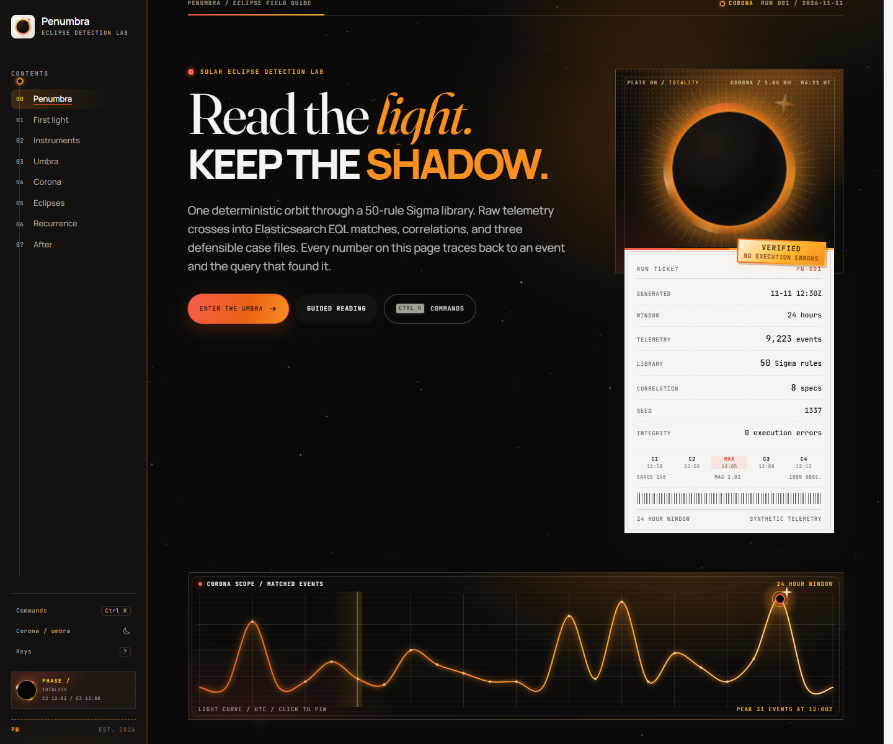
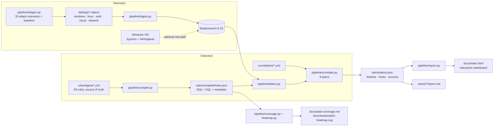
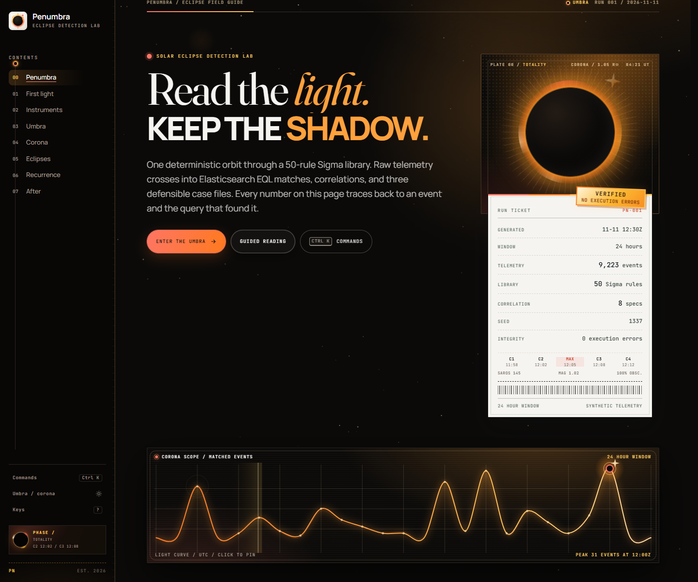

# Penumbra

**A solar eclipse detection lab. Read the light, keep the shadow.**

[](pyproject.toml)
[](docker-compose.yml)
[](rules/sigma)
[](tests)
[](docs/attck-coverage.md)
[](LICENSE)
[](.github/workflows/ci.yml)



Penumbra is a detection lab you can rerun. It generates 9,223 synthetic events, compiles 50 Sigma rules to Elasticsearch EQL and KQL, runs them against a local Elasticsearch stack, correlates the matches, and turns the result into an interactive dashboard and three analyst case reports. Every number in the dashboard traces to an event and the query that found it.

> **Project status: portfolio lab, not a production detection product.** The telemetry is synthetic and generated to exercise this rule set. The repository demonstrates detection-as-code, validation, triage, and reporting; it does not claim production precision or recall. The evidence boundary is documented in [Evaluation and validation](docs/evaluation.md).

**Repository status:** public. The dashboard is live at <https://meruyert5.github.io/penumbra/>. Run the site locally from `site/` after `python -m pipeline.report` and `python -m pipeline.publish`.

## Reviewer path

| Time | Open | Why it matters |
|---|---|---|
| 2 minutes | [The live dashboard](https://meruyert5.github.io/penumbra/) | See the run, the peak hour, the coverage ring, and the triage queue |
| 5 minutes | [`rules/sigma/`](rules/sigma) and [`rules/compiled/`](rules/compiled) | Read the source rule and the EQL/KQL that Elasticsearch actually runs |
| 5 minutes | [`cases/case-002-multi-stage-intrusion/report.md`](cases/case-002-multi-stage-intrusion/report.md) | Follow one investigation from alert to verdict |
| 5 minutes | [`docs/attck-coverage.md`](docs/attck-coverage.md) and [`docs/tuning.md`](docs/tuning.md) | Check coverage and the tuning record |
| 2 minutes | [`integrations/apsis/README.md`](integrations/apsis/README.md) | Read the validated Apsis handoff: a seven-hop route, its evidence, cut, and guardrails |
| 2 minutes | [`tests/`](tests) and [`ci.yml`](.github/workflows/ci.yml) | See rules treated as reviewed software |

## What this is, and what it is not

| This repository is | This repository is not |
|---|---|
| A reproducible detection-as-code lab with a deterministic run | A production SIEM deployment |
| A portfolio of 50 reviewed Sigma rules, 8 correlation specs, and 3 case reports | A benchmark of vendor detection efficacy |
| A demonstration of EQL/KQL compilation, ATT&CK coverage, and triage UX | A source of real incident data or threat intelligence |
| A baseline for learning, review, and extension | A claim of production precision, recall, or coverage completeness |

## What you can inspect

| What you can inspect | Where |
|---|---|
| Sigma as the source of truth, compiled to EQL and KQL | [`rules/sigma/`](rules/sigma), [`pipeline/compile.py`](pipeline/compile.py) |
| SIEM operations on Elasticsearch and Kibana | [`docker-compose.yml`](docker-compose.yml), [`config/`](config) |
| Threshold and distinct-value correlation, tested without a SIEM | [`correlations/`](correlations), [`pipeline/correlate.py`](pipeline/correlate.py) |
| Analyst-quality incident write-ups | [`cases/`](cases) |
| Hypothesis-driven hunts with evidence and verdicts | [`hunts/`](hunts) |
| Dry-run triage, incident grouping, and response playbooks | [`response/`](response) |
| CloudTrail detections for the Apsis hand-off | [`cloud/`](cloud) |
| IR close-outs with metrics, recovery, and lessons | [`cases/IR.md`](cases/IR.md) |
| The three-project roadmap | [`docs/roadmap.md`](docs/roadmap.md) |
| ATT&CK coverage with an explicit gap view | [`docs/attck-coverage.md`](docs/attck-coverage.md) |
| Detection tuning with recorded false positives | [`docs/tuning.md`](docs/tuning.md) |
| Tests and CI that treat rules like software | [`tests/`](tests), [`.github/workflows/ci.yml`](.github/workflows/ci.yml) |
| A dashboard a reviewer can click through | [`docs/index.html`](docs/index.html) |

---

## At a glance

| | |
|---|---|
| **Detections** | 50 Sigma rules and 8 correlation specs |
| **Telemetry** | 9,223 deterministic events across Windows, Linux, web, AWS, and network flows |
| **Scenarios** | 33 attack scenarios plus a benign baseline, spread across a 24-hour window |
| **Coverage** | 48 ATT&CK techniques, 13 tactics, 45 of 45 priority techniques, 0 gaps |
| **Hunts** | 4 hypothesis-driven hunts over 9,223 events, with evidence and detection changes |
| **Response** | 27 dry-run incidents, 6 playbooks, 78 recommended actions, 85% containment coverage |
| **Correlation** | Sliding windows with optional distinct-value thresholds, for example 10 attempts across 8 accounts |
| **Backend** | Elasticsearch 8.15.3 and Kibana 8.15.3, single node, security disabled for lab use |
| **Tests** | 79 passing: lint, compilation, correlation, lab generation, coverage, publishing, replay mapping, benchmark metrics, hunts, validation table, secret scan, dashboard assembly |
| **Validation** | 1,381 real events across five indices and 16 labelled windows; 5 rules matched; 6 TP / 0 FP / 1 FN; 0 not evaluable; 89,704-event benign baseline |
| **Frontend** | One self-contained HTML file with no build step, CDN, or network request |

---

## How it works



The repo has two ingestion paths on purpose:

* **Synthetic.** `pipeline/labgen.py` emits deterministic ECS-shaped events from named attack scenarios. It needs no VM, works in CI, and reproduces every number in this README.
* **Real.** Point a Windows VM running Sysmon and Winlogbeat at the same Elasticsearch with [`config/winlogbeat.yml`](config/winlogbeat.yml), then switch [`config/logsource_map.yml`](config/logsource_map.yml) to the `logs-windows.*` data streams.

> All telemetry in this repo is synthetic lab data and is labelled as such. It models attacker behaviour. It is not a production baseline.

### Data provenance

`pipeline/labgen.py` is the source of the run. The committed dashboard uses seed `1337` and base time `2026-11-11T12:30:00Z`; the same commands reproduce the same event count and timestamps. Every host, user, and address is synthetic. IP addresses use RFC 5737 documentation ranges, and the repository contains no customer logs, credentials, or personal data.

The current corpus is deliberately small and narrow: 9,223 events across Windows, Linux, web, AWS CloudTrail, and network flow over 24 hours. That is enough to exercise this rule set and keep CI fast. It is not enough to measure production noise tolerance, precision, or recall. See [Evaluation and validation](docs/evaluation.md) for what is measured, what is not, and how to extend the evidence with public real-telemetry datasets.

---

## Quickstart

### Requirements

* Python 3.11, 3.12, or 3.13. pySigma does not support 3.14 yet.
* Docker Desktop with Compose v2.
* About 4 GB of free RAM for Elasticsearch and Kibana.

### 1. Create the Python environment

Windows PowerShell:

```powershell
py -3.11 -m venv .venv
.\.venv\Scripts\Activate.ps1
python -m pip install -r requirements.txt
```

macOS or Linux:

```bash
python3.11 -m venv .venv
source .venv/bin/activate
python -m pip install -r requirements.txt
```

The Python pipeline is cross-platform. The helper scripts in [`scripts/`](scripts) are PowerShell.

### 2. Start Elasticsearch and Kibana

```powershell
docker compose up -d
```

Kibana is at `http://localhost:5601`. Security and TLS are disabled on purpose. Keep the stack on localhost.

### 3. Generate and index the snapshot

```powershell
python -m pipeline.labgen --scenario all --base-time 2026-11-11T12:30:00Z
python -m pipeline.ingest --reset
```

The `--base-time` value matches the committed dashboard. Omit it for a run against the current clock. The event count stays at 9,223, but the timestamps move.

### 4. Compile and run the detections

```powershell
python -m pipeline.compile
python -m pipeline.detect --hours 24 --end 2026-11-11T12:30:00Z
```

This writes `alerts/summary.md` and `alerts/alerts.json`. Omit `--end` for a live run against current telemetry.

### 5. Build the dashboard

```powershell
python -m pipeline.report --open
```

`docs/index.html` is the result. It works from `file://`, from a static server, and on GitHub Pages.

### Run without Docker

These steps cover everything except the live Elasticsearch path:

```powershell
python -m pytest
python -m pipeline.lint
python -m pipeline.compile
python -m pipeline.coverage
python -m pipeline.heatmap
python -m pipeline.labgen --scenario all
python -m pipeline.correlate --input lab/logs/linux.ndjson
```

[`scripts/demo.ps1`](scripts/demo.ps1) runs the same Docker-free sequence on Windows. `pipeline.report` is not part of this path because it needs `alerts/alerts.json`, and only `pipeline.detect` writes that file.

---

## Commands

| Command | What it does |
|---|---|
| `python -m pipeline.labgen --scenario all` | Writes deterministic NDJSON telemetry to `lab/logs/` |
| `python -m pipeline.ingest --reset` | Deletes `lab-*` indices and indexes the NDJSON files |
| `python -m pipeline.compile` | Compiles Sigma to EQL and KQL under `rules/compiled/` |
| `python -m pipeline.detect --hours 24` | Runs every rule and correlation, writes `alerts/` |
| `python -m pipeline.detect --dry-run` | Prints the queries without running them |
| `python -m pipeline.hunts` | Runs four hypothesis-driven hunts over the lab corpus |
| `python -m pipeline.cloud_pack` | Evaluates the cloud detection pack |
| `python -m pipeline.triage` | Runs dry-run enrichment, grouping, and playbooks |
| `python -m pipeline.casebook` | Renders the IR close-outs into `cases/IR.md` |
| `python -m pipeline.replay --source FILE` | Normalizes an OTRF/Mordor sample into lab NDJSON |
| `python -m pipeline.validation` | Writes the synthetic per-rule results table |
| `python -m pipeline.validation_results --write-results` | Writes the dashboard validation manifest |
| `python -m pipeline.benchmark --labels FILE` | Computes per-rule TP/FP/FN, precision, recall, and volume |
| `python -m pipeline.correlate --input FILE` | Runs correlation over an exported NDJSON file |
| `python -m pipeline.report --open` | Builds and opens `docs/index.html` |
| `python -m pipeline.publish` | Copies only the dashboard, assets, and cases into `site/` for Pages |
| `python -m pipeline.coverage` | Regenerates `docs/attck-coverage.md` |
| `python -m pipeline.heatmap` | Regenerates `docs/assets/attck-heatmap.svg` |
| `python -m pipeline.lint` | Fails on missing rule metadata or ATT&CK tags |
| `python -m pytest` | Runs the test suite |

Use `--check` with `pipeline.compile` or `pipeline.coverage` to fail when the committed artifact is stale. CI uses both flags.

---

## Detection library

50 Sigma rules: 34 high, 8 medium, 5 critical, and 3 low. Every rule carries `description`, `references`, `falsepositives`, `level`, and ATT&CK tags. [`pipeline/lint.py`](pipeline/lint.py) enforces that metadata, so a rule without tuning notes or a technique mapping fails CI.

| Source | Rules | Examples |
|---|---|---|
| Windows (Sysmon, Security, System) | 30 | LSASS access, encoded PowerShell, remote thread creation, ADMIN$ access, service install, registry Run key |
| Linux (auth, audit, cron) | 10 | reverse shell, valid-account login, root SSH, SSH key modification, sudoers change, systemd unit |
| Web (nginx) | 7 | PHP upload, web shell parameter, C2 beacon, command injection, SQL injection, path traversal, scanner user agent |
| Cloud (AWS CloudTrail) | 2 | access key creation, root console login |
| Network (flow) | 1 | large outbound transfer |

### Correlation library

Sigma aggregation support varies by backend, so the base rules stay single-event and portable. [`pipeline/correlate.py`](pipeline/correlate.py) applies sliding-window logic and is unit-testable without a SIEM.

| Spec | Logic | Technique |
|---|---|---|
| `corr-ssh-bruteforce` | 8 failures / 5 min / source IP | T1110.001 |
| `corr-password-spray` | 10 failures across 8 distinct accounts / 10 min | T1110.003 |
| `corr-port-scan` | 20 inbound flows / 1 min / source IP | T1046 |
| `corr-discovery-burst` | 4 discovery commands / 5 min / host | T1087 |
| `corr-ransomware-file-burst` | 15 file writes / 2 min / host | T1486 |
| `corr-web-scan` | 20 requests / 1 min / source IP | T1595.002 |
| `corr-web-shell-burst` | 5 web shell requests / 2 min / source IP | T1505.003 |
| `corr-dns-tunnel` | 12 DNS queries / 2 min / host | T1071.004 |

---

## Case reports

| Case | Scenario | Verdict |
|---|---|---|
| [001: SSH brute force](cases/case-001-ssh-bruteforce/report.md) | 14 failures, then a success from `203.0.113.44` | True positive, successful unauthorized access |
| [002: Multi-stage intrusion](cases/case-002-multi-stage-intrusion/report.md) | Macro, encoded PowerShell, certutil, LSASS, persistence | True positive, credential theft and persistence |
| [003: Ransomware sequence](cases/case-003-ransomware/report.md) | Recovery deletion, service stops, notes, 24 encrypted files | True positive, contained before the share was lost |

Each report follows the same structure: summary, timeline, evidence, analysis, ATT&CK mapping, verdict, containment, detection improvements, and reproduction steps.

---

## ATT&CK coverage


The matrix is generated from compiled rules and correlations, not hand-maintained. Covered tiles name the rule that closes them. Dashed tiles are the next rules to write, not omissions hidden inside a percentage. The full report is in [`docs/attck-coverage.md`](docs/attck-coverage.md).

Representative coverage:

| Technique | Name | Detection |
|---|---|---|
| T1003.001 | LSASS Memory | LSASS Process Access |
| T1059.001 | PowerShell | PowerShell Encoded Command Execution |
| T1486 | Data Encrypted for Impact | Ransomware Note and File Burst |
| T1490 | Inhibit System Recovery | Shadow Copy Deletion and BCDEdit Recovery Disabled |
| T1021.004 | SSH | Root SSH Login from an External Address |
| T1071.001 | Web Protocols | Periodic Web Beacon to a Command Endpoint |

---

## The dashboard

[`docs/index.html`](docs/index.html) is generated by [`pipeline/report.py`](pipeline/report.py) and is completely self-contained. It works offline, from `file://`, and on GitHub Pages.

* A dark corona scope on the cover that scans the same hourly run as the chart, with pings where volume crosses the peak threshold; click it to pin that hour on the chart. It is a warm sunset light curve in both Corona and Umbra, with a black-disc peak marker.
* A full-bleed night stage with a live starfield, a sun/moon eclipse that shifts with the selected contact, and a ghost wordmark
* A pinned scroll-scrubbed totality act with a giant sun/moon, Baily's beads, a diamond ring, and a progress rail
* Validation, hunting, response, IR, and roadmap distributed across the chapters. The validation view has a 50-rule status matrix, source cards, a click-to-expand per-rule TP/FP/FN table, a proof drawer, and a downloadable manifest
* A kinetic phase ticker and a horizontal case reel with previous/next controls
* A five-stop contact ribbon (C1, C2, totality, C3, C4) and a gradient path-of-totality plate with the observing window, a real data-peak marker, and contacts that open the hour in the watch floor
* A run ticket with contact times, Saros 145, magnitude 1.02, 100% obscuration, and a paper receipt texture
* Auto-replaying hourly signal chart with a smoothed envelope, quiet-baseline markers, event severity, and an event-versus-detection split
* A 45-tick radial corona ring for priority coverage, with the score in the eye of the eclipse
* Watch floor with a fixed evidence inspector, host lanes, severity chips, host filter, sort, free-text search (`/` focuses it), CSV export of the filtered queue, and a focus/fullscreen mode
* Separate tab for correlation alerts, including threshold, window, and distinct-account counts
* Expand any detection to see the raw evidence events and the exact EQL and KQL that fired
* Clickable ATT&CK matrix that filters the watch floor by technique, with hover cards naming the detection that covers each tile, plus a gaps-only view
* Inspector timing bars showing when each detection was first and last seen in the window
* EQL and KQL panels with syntax highlighting and one-click copy
* Case cards with a detection chain that opens a case-file summary and links to the published investigation reports
* A case-chain player that steps through each investigation's detections in order, with the rule, time, host, and EQL for every step
* A response flow, hunt radar, IR timeline scrubber, cloud hand-off bridge, and project vinyl record, each with a selector and one detail pane
* A validation matrix with focusable rule tiles and a live status readout, plus a per-rule benchmark table
* A host-lane hour axis and a severity-mix bar in the watch floor status band
* Two eclipse themes: **Corona** (paper, sunlight, coral) and **Umbra** (black sky, corona glow), each with its own accent, plus a contact-ribbon play control (`P`), a command palette (`Ctrl/Cmd K`), a guided fifteen-step reading, keyboard shortcuts, and reduced-motion support
* Copy buttons for every command and query

The source is split for maintenance: [`dashboard/template.html`](dashboard/template.html), [`dashboard/styles.css`](dashboard/styles.css), [`dashboard/app.js`](dashboard/app.js), [`dashboard/icon.svg`](dashboard/icon.svg), and the locally embedded WOFF2 files in [`dashboard/fonts/`](dashboard/fonts). The report step inlines the source and the fonts into one HTML file.

The design system, motion rules, contrast evidence, and accessibility contract are in [`docs/design.md`](docs/design.md).

Chrome Lighthouse against the built page reports **100 accessibility, 100 best practices, and 100 SEO**. Performance is not part of that audit, so this repo does not publish a performance score.

<p align="center">
  
</p>

---

## Use real telemetry

1. Install Sysmon on the Windows VM with the SwiftOnSecurity or Olaf Hartong configuration.
2. Copy [`config/winlogbeat.yml`](config/winlogbeat.yml) and set `output.elasticsearch.hosts` to the lab machine's LAN address.
3. Run `.\install-service-winlogbeat.ps1`, then `Start-Service winlogbeat`.
4. In [`config/logsource_map.yml`](config/logsource_map.yml), point `windows` at `logs-windows.sysmon_operational-*`, `logs-windows.security-*`, and `logs-windows.system-*`.
5. For Linux, ship `auth.log` and audit logs with Filebeat or Elastic Agent, then point the `linux` entry at those data streams.
6. Recompile and rerun: `python -m pipeline.compile`, then `python -m pipeline.detect`.

Verify the fields your rules depend on before trusting a "no alerts" result:

```powershell
curl.exe "http://localhost:9200/logs-windows.sysmon_operational-*/_mapping" | Select-String "executable.caseless"
```

The `.caseless` fields come from the Winlogbeat processors. Without them, rules that match process paths case-insensitively will silently never fire.

---

## Tests and CI

```powershell
python -m pytest -q
```

The 79 tests cover rule metadata, Sigma compilation, correlation windows and distinct counts, telemetry generation, coverage accounting, public-site publishing, OTRF/Mordor, auditd, auth, nginx, Zeek, and Windows XML replay mapping, the synthetic per-rule table, benchmark metrics, hypothesis-driven hunts, cloud detections, triage, the IR casebook, a high-confidence secret-pattern scan, and dashboard assembly.

[`.github/workflows/ci.yml`](.github/workflows/ci.yml) runs on every push and pull request:

1. `python -m pipeline.lint`
2. `python -m pipeline.compile` and `python -m pipeline.compile --check`
3. `python -m pipeline.coverage` and `python -m pipeline.coverage --check`
4. `python -m pipeline.heatmap`, then a `git diff --exit-code` check on the SVG
5. `python -m pytest`
6. `python -m pipeline.labgen --scenario all` as a smoke test

Generated artifacts are committed so reviewers can read them without running anything. CI fails when they drift.

---

## Troubleshooting

| Symptom | Cause | Fix |
|---|---|---|
| `PUT _index_template` returns 400 `can't merge a non object mapping` | Elasticsearch treats dots in field names as object paths, so `process.executable` and `process.executable.caseless` collide | `"subobjects": false` on `process` and `process.parent`, already set in [`config/index-template.json`](config/index-template.json) |
| `DELETE lab-*` returns 400 `Wildcard expressions or all indices are not allowed` | Elasticsearch 8 sets `action.destructive_requires_name` | Delete named indices. `pipeline/ingest.py` does this for you |
| Detections report `Unknown index [lab-windows]` | Ingestion never created the index, so every EQL search fails | Fix ingestion first and confirm with `GET _cat/indices/lab-*` |
| `0 rule matches` but events are indexed | Field mapping mismatch, most often a missing `.caseless` field | Run `GET lab-*/_mapping` and compare with [`config/index-template.json`](config/index-template.json) |
| `pipeline.report` says `alerts/alerts.json` is missing | The detection run has not produced output yet | Run `python -m pipeline.detect` first |
| Kibana is not reachable yet | It waits for Elasticsearch health | Run `docker compose ps`, then retry after about 30 seconds |

---

## Evaluation and validation

The current evidence is structural and behavioural, not statistical. CI proves that every rule has metadata and ATT&CK tags, compiles to EQL/KQL, stays in sync with generated artifacts, and fires on the matching lab scenario. The benign baseline proves that a small set of ordinary activity does not trip the correlation thresholds. None of that is a precision or recall measurement.

| Evidence | Status |
|---|---|
| Deterministic synthetic run | Done: 9,223 events, 33 attack scenarios plus baseline |
| Rule metadata and ATT&CK tags enforced | Done: `pipeline.lint` |
| Compilation and artifact drift | Done: `pipeline.compile --check`, `pipeline.coverage --check` |
| Scenario-to-detection tests | Done for the committed scenarios |
| Benign baseline | Small, not a production noise model |
| Real multi-source replay | Done: 1,381 events, five indices, 16 labelled windows |
| Per-rule benchmark | Done: 6 TP, 0 FP, 1 FN; precision 1.000, recall 0.857 |
| Production precision / recall | Not claimed |

The combined real-data step is complete: 1,381 events from Windows Security,
Sysmon, service/Kerberos/SMB XML, Linux auditd and auth, nginx, AWS CloudTrail,
and Zeek connection logs were replayed into five indices. Sixteen reviewed
windows produced six sample-level true positives and one false negative: the SMB
rule queries Security 5140, while the capture logged ADMIN$ access as 5145.
Five rules had precision and recall of 1.000; the SMB rule had recall 0.000.
That is a real small-sample benchmark, not an enterprise precision or recall
measurement. A separate 89,704-event synthetic benign baseline produced one
low-severity SSH match. See
[Real-telemetry replay results](docs/validation/real-telemetry-results.md),
[Benchmark metrics](docs/validation/benchmark.md), and
[Large benign baseline](docs/validation/large-benign-results.md).

## Threat hunting

`pipeline.hunts` runs four hypothesis-driven hunts over the deterministic corpus:
root identity activity in AWS, service binaries outside trusted paths, DNS
tunneling patterns, and LSASS access from user-writable paths. Each hunt records
the question, the query, the evidence, the verdict, and the detection change it
recommends. See [hunts/README.md](hunts/README.md).

Hunting sits in Umbra, validation in Corona, response in Instruments, and the IR
close-outs in Eclipses. The three-project roadmap and the Apsis cloud hand-off
are in the final After chapter. The roadmap is also in
[docs/roadmap.md](docs/roadmap.md).

## Response and IR

`pipeline.triage` turns the detection run into 27 incidents, enriches each one,
and selects a playbook from six options. It recommends 78 actions and reaches
85% containment coverage. No EDR, cloud, or ticketing API is called; the output
is a response design, not a claim that a host was isolated. See
[response/README.md](response/README.md).

`pipeline.cloud_pack` evaluates three CloudTrail detections that complement
Apsis: root policy attachment, root user creation, and CloudTrail tampering.
Two fire on the synthetic corpus; one is waiting for telemetry. See
[cloud/README.md](cloud/README.md).

The three cases now have a structured close-out layer: observed window, detection
span, containment, eradication, recovery, communication, evidence, lessons, and
open questions. See [cases/IR.md](cases/IR.md).


## Limitations

* Single-node Elasticsearch with security disabled. This is a lab, not a production deployment.
* Synthetic telemetry covers the detections in this repo. It does not model an enterprise baseline, so precision figures are illustrative, not production measurements.
* Correlation runs in-process over a bounded event fetch of 10,000 events. That is fine for the lab and wrong at production scale.
* All 45 priority techniques are covered in this lab. The gaps view remains as a regression check. Production precision still depends on real telemetry and tuning.
* The dashboard is a static snapshot of one run. It is not a live SIEM view.
* There is no memory or API telemetry beyond LSASS handle access, so process injection and in-memory credential theft remain partly blind.

---

## Repository layout

```text
rules/sigma/            Sigma rules (source of truth)
rules/compiled/         Generated EQL/KQL and metadata (committed for review)
correlations/           Threshold and distinct-value correlation specs
pipeline/               compile, lint, coverage, labgen, ingest, detect, correlate, report, publish, heatmap
dashboard/              Dashboard source: template, styles, script, icon, fonts
config/                 Elasticsearch template, Filebeat, Winlogbeat, index routing
lab/logs/               Generated telemetry (gitignored)
alerts/                 Detection output (gitignored)
cases/                  Analyst case reports and dashboard metadata
integrations/           Delivered cross-project handoffs (Apsis alert + evidence)
docs/                   Dashboard, design system, runbook, tuning log, ATT&CK coverage, evaluation, publishing, validation
site/                   Generated public site (dashboard + assets + cases; gitignored)
tests/                  pytest suite
scripts/                Convenience scripts
```

---

## Publish the dashboard

[`.github/workflows/pages.yml`](.github/workflows/pages.yml) publishes a filtered public site on every push to `main`:

The live dashboard is <https://meruyert5.github.io/penumbra/>. The workflow deploys on every push to `main`.

```powershell
python -m pipeline.report
python -m pipeline.publish
```

`pipeline.publish` writes `site/` with only `index.html`, `assets/`, `cases/`, `.nojekyll`, and `CNAME` when a custom domain is configured. The design notes, research log, runbook, and tuning record stay in `docs/` and are not uploaded to Pages. This is a deployment boundary, not a secrecy guarantee: `dashboard/` is still part of this repository.

Pages is already enabled for this repository. For a fork:

1. Open **Settings → Pages** and set **Source** to **GitHub Actions**.
2. Push to `main` or run the workflow manually. GitHub shows the published URL in the workflow run and in **Settings → Pages**.

The dashboard has no server-side dependencies, so Pages serves it as-is. If you fork the repo under a different name, the workflow still publishes `site/`; no code change is needed.

See [Publishing checklist](docs/publishing.md) for repository metadata, the design-privacy options, and the post-deploy checks.

---

## Roadmap

The full three-project roadmap is in [docs/roadmap.md](docs/roadmap.md) and
the After chapter.

- **Penumbra:** complete. Detection library, validation, hunting, IR casebook,
  triage automation, the cloud detection pack, and the live dashboard are done.
- **Apsis:** complete. Graph, minimum cut, drift, observed paths, guardrails,
  the case study, live IAM import, the eight-view console, and the validated
  Penumbra alert/evidence handoff are done. Repository upload is the remaining
  release step.
- **Network threat hunting:** build after the two existing projects are complete.

Other backlog items:

- [ ] Add a larger real benign baseline
- [ ] Add Kibana saved objects so detections and dashboards deploy as code
- [ ] Wire `pipeline/detect.py` into a webhook notifier for a simulated on-call flow
- [ ] Add a Zeek or PCAP source and a beaconing detection with jitter analysis

---

## Contributing and security

Read [`CONTRIBUTING.md`](CONTRIBUTING.md) before changing a rule or the pipeline. Report vulnerabilities through GitHub's private reporting flow described in [`SECURITY.md`](SECURITY.md). The lab threat model is in [`docs/threat-model.md`](docs/threat-model.md). Do not open a public issue for a security problem, and do not submit real logs, credentials, or personal data.

## Support

The repository includes a `.github/FUNDING.yml` and is ready for a Sponsor button. GitHub Sponsors payouts depend on the maintainer's region; see [Publishing checklist](docs/publishing.md#sponsorship) for the supported paths. For now, the best support is a review, a reproducible issue, or sharing the dashboard.

## Author

**Meruyert Oshayeva** — detection engineering, detection-as-code, and interface design.

This is an independent portfolio project. It is not affiliated with any company using the Penumbra name. The visual identity, the run, and the writing are part of the portfolio; the rules and pipeline are MIT-licensed for reuse.

## License

[MIT](LICENSE). Use the rules and pipeline freely. Attribution is appreciated.

The MIT license covers the pipeline, rules, tests, configuration, and documentation. The Penumbra name, wordmark, eclipse mark, and dashboard screenshots are brand identifiers; the license does not grant trademark rights. This is an independent portfolio project and is not affiliated with any company using the Penumbra name. If you plan to reuse the visual identity in a product, please ask first.

See [`NOTICE.md`](NOTICE.md) for copyright, font, and third-party notices.
