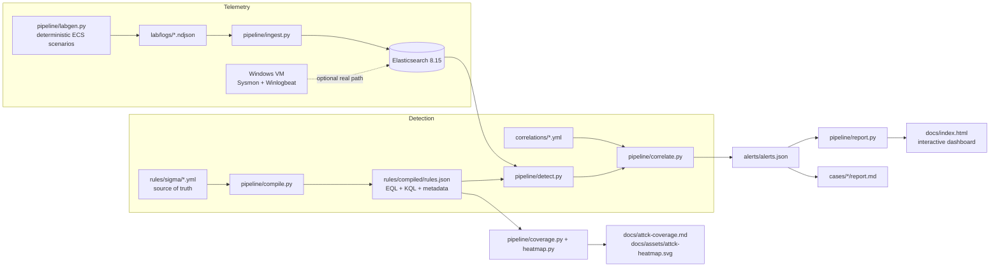

# Detection Forge

**Detection-as-code for the full SOC loop: Sigma → Elasticsearch EQL → triage → case report → ATT&CK coverage.**

[](pyproject.toml)
[](docker-compose.yml)
[](rules/sigma)
[](tests)
[](docs/attck-coverage.md)
[](LICENSE)
[](https://github.com/YOUR-USERNAME/detection-forge/actions/workflows/ci.yml)

> Replace `YOUR-USERNAME` with your GitHub handle after the first push (see [Publishing](#publishing)).


<p align="center">
  <a href="https://YOUR-USERNAME.github.io/detection-forge/"><b>▶ Open the interactive dashboard</b></a>
  &nbsp;·&nbsp;
  <a href="cases/case-002-multi-stage-intrusion/report.md">Read case 002</a>
  &nbsp;·&nbsp;
  <a href="docs/attck-coverage.md">ATT&CK coverage</a>
</p>

---

## Why this exists

Most portfolio projects stop at "I wrote some rules." A real detection engineer owns the whole loop: collect telemetry, write and tune detections, investigate what fires, decide true/false positive, document the incident, and measure what is still blind.

Detection Forge is that loop, made reproducible. Every alert in this repo can be regenerated on a fresh machine from a single scenario generator — no screenshots of someone else's SIEM, no unverifiable claims.

| What a reviewer can check | Where |
|---|---|
| Sigma as the source of truth, compiled to EQL + KQL | [`rules/sigma/`](rules/sigma), [`pipeline/compile.py`](pipeline/compile.py) |
| SIEM operations on a real Elasticsearch/Kibana stack | [`docker-compose.yml`](docker-compose.yml), [`config/`](config) |
| Threshold and correlation logic, tested without a SIEM | [`correlations/`](correlations), [`pipeline/correlate.py`](pipeline/correlate.py) |
| Analyst-quality incident write-ups | [`cases/`](cases) |
| ATT&CK coverage **and honest gap analysis** | [`docs/attck-coverage.md`](docs/attck-coverage.md) |
| Detection tuning with recorded false positives | [`docs/tuning.md`](docs/tuning.md) |
| Tests and CI that treat rules like software | [`tests/`](tests), [`.github/workflows/ci.yml`](.github/workflows/ci.yml) |
| A dashboard a hiring manager can click through | [`docs/index.html`](docs/index.html) |

---

## At a glance

| | |
|---|---|
| **Detections** | 11 Sigma rules + 2 threshold correlations |
| **Coverage** | 12 ATT&CK techniques · 7 tactics · 10 priority gaps documented |
| **Telemetry** | 186 deterministic synthetic events across Windows, Linux, and a web server |
| **Live run** | 11 rule matches (1 critical, 6 high, 3 medium, 1 low) + 2 correlation alerts |
| **Backend** | Elasticsearch 8.15.3 + Kibana 8.15.3, single node, security disabled (lab only) |
| **Tests** | 25 passing: lint, compilation, correlation, lab generation, coverage |

---

## Architecture



Two ingestion paths exist on purpose:

* **Synthetic** — `pipeline/labgen.py` emits deterministic ECS-shaped events from named attack scenarios. CI-friendly, no VM required, and every result in this README is reproducible.
* **Real** — point a Windows VM running Sysmon at the same Elasticsearch with [`config/winlogbeat.yml`](config/winlogbeat.yml), then switch [`config/logsource_map.yml`](config/logsource_map.yml) to the `logs-windows.*` data streams.

> All telemetry committed or shown here is **synthetic lab data**, clearly labelled as such. It models attacker behaviour; it is not a production baseline.

---

## The dashboard

[`docs/index.html`](docs/index.html) is generated by `pipeline/report.py` and is completely self-contained — no build step, no CDN, no network. It works offline and on GitHub Pages.

* Severity and host filters, plus free-text search (`/` focuses it)
* Expand any detection to see the **raw evidence events and the exact EQL query** that fired
* Attack-sequence timeline for the most-affected host
* Priority-coverage donut and events-per-host breakdown
* Clickable ATT&CK heatmap that filters the detection list by technique

Regenerate it at any time:

```powershell
.\.venv\Scripts\python.exe -m pipeline.report --open
```

---

## ATT&CK coverage


The matrix is generated from the compiled rules, not hand-maintained. Gaps are intentional and listed as the next rules to write in [`docs/attck-coverage.md`](docs/attck-coverage.md).

---

## Quickstart

**Requires:** Python 3.11 (pySigma does not support 3.14 yet), Docker Desktop, ~4 GB free RAM.

```powershell
# 1. Python environment
py -3.11 -m venv .venv
.\.venv\Scripts\python.exe -m pip install -r requirements.txt

# 2. Start Elasticsearch + Kibana
docker compose up -d
# Kibana: http://localhost:5601  (security is disabled: lab only)
#
# Filebeat is optional and only starts with the beats profile:
#   docker compose --profile beats up -d
# The default path indexes telemetry directly with pipeline/ingest.py,
# so the same events are not loaded twice.

# 3. Generate synthetic telemetry and index it
.\.venv\Scripts\python.exe -m pipeline.labgen --scenario all
.\.venv\Scripts\python.exe -m pipeline.ingest --reset

# 4. Run the detections
.\.venv\Scripts\python.exe -m pipeline.detect --hours 24
# -> alerts/summary.md and alerts/alerts.json

# 5. Build the dashboard
.\.venv\Scripts\python.exe -m pipeline.report --open
```

Expected output:

```text
11 rule matches | 2 correlation alerts
  critical 1   high 6   medium 3   low 1
```

**Offline, with no Docker:**

```powershell
.\.venv\Scripts\python.exe -m pytest          # rule lint, compilation, correlation, labgen
.\.venv\Scripts\python.exe -m pipeline.lint   # metadata quality gate
.\.venv\Scripts\python.exe -m pipeline.compile
.\.venv\Scripts\python.exe -m pipeline.coverage
```

[`scripts/demo.ps1`](scripts/demo.ps1) runs the offline pipeline end to end.

### Triage in Kibana

1. Create a data view for `lab-*`.
2. Open `rules/compiled/rules.json` and copy any `query_kql`.
3. Paste it into **Discover** and compare the hits with the evidence in the dashboard.

---

## Detections

| Rule | Level | Technique | Source |
|---|---|---|---|
| Suspicious Process Access to LSASS | critical | T1003.001 | Sysmon EID 10 |
| PowerShell Encoded Command Execution | high | T1059.001 | Sysmon EID 1 |
| Certutil Used to Download or Decode a Payload | high | T1105, T1140 | Sysmon EID 1 |
| Suspicious Service Installed From User-Writable Path | high | T1543.003 | System EID 7045 |
| Windows Defender Real-Time Protection Disabled | high | T1562.001 | Defender EID 5001/5010/5012 |
| Cron Job Executing Remote Content | high | T1053.003 | Linux cron |
| PHP File Uploaded to Web Accessible Directory | high | T1505.003 | nginx access log |
| Scheduled Task Created via Schtasks | medium | T1053.005 | Sysmon EID 1 |
| New Local User Account Created | medium | T1136.001 | Linux auth log |
| Web Request to Common Web Shell Parameter | medium | T1505.003 | nginx access log |
| SSH Failed Password Authentication | low | T1110.001 | Linux auth log |

**Correlations:** SSH brute force (8 failures / 5 min / source IP) and web-shell command burst (5 requests / 2 min / source IP).

Every rule carries `description`, `references`, `falsepositives`, `level`, and ATT&CK tags. [`pipeline/lint.py`](pipeline/lint.py) enforces that metadata, so a rule without tuning notes or a technique mapping fails CI.

---

## Case reports

| Case | Scenario | Verdict |
|---|---|---|
| [001 — SSH brute force](cases/case-001-ssh-bruteforce/report.md) | 14 failed logins, then a success from `203.0.113.44` | True positive, attempted intrusion |
| [002 — Multi-stage intrusion](cases/case-002-multi-stage-intrusion/report.md) | Macro → encoded PowerShell → certutil → LSASS access → persistence | True positive, credential theft and persistence |

Both follow the same analyst structure: summary, timeline, evidence, scope, ATT&CK mapping, verdict, containment, and lessons learned.

---

## Design decisions

**Sigma is the source of truth, not the SIEM query.** Rules stay portable; the compiled EQL/KQL under `rules/compiled/` is a build artifact regenerated by CI. The repo is not locked to one vendor, and rule changes are reviewed as code.

**Threshold logic lives outside Sigma.** Sigma aggregation support varies by backend, so base rules remain single-event and portable. [`pipeline/correlate.py`](pipeline/correlate.py) applies sliding-window "N events in T seconds" logic and is unit-testable without a SIEM.

**Field mapping is explicit.** Windows rules use Sigma-native names and pass through pySigma's ECS pipeline: `Image` → `process.executable.caseless`, `EventID` → `event.code`. The `.caseless` variants come from Winlogbeat processors because case-insensitive path matching is a real-world requirement, not a nicety.

**Tuning is documented, not implied.** [`docs/tuning.md`](docs/tuning.md) records each false positive found in the lab, the change made, and the effect. A detection without a tuning history is an untested hypothesis.

**Generated artifacts are committed and checked.** `rules/compiled/` and `docs/attck-coverage.md` are in git so reviewers can read them without running anything; CI runs `--check` and fails on drift.

---

## Repository layout

```text
rules/sigma/            Sigma rules (source of truth)
rules/compiled/         Generated EQL/KQL + metadata (committed for review)
correlations/           Threshold correlation specs
pipeline/               compile, lint, coverage, labgen, ingest, detect, correlate, report, heatmap
config/                 Elasticsearch template, Filebeat, Winlogbeat, index routing
lab/logs/               Generated telemetry (gitignored)
alerts/                 Detection output (gitignored)
cases/                  Analyst case reports
docs/                   Interactive dashboard, architecture, runbook, tuning, ATT&CK coverage
tests/                  pytest suite
scripts/                Convenience scripts
```

---

## Using real telemetry

1. Install Sysmon on the Windows VM (SwiftOnSecurity or Olaf Hartong config).
2. Copy `config/winlogbeat.yml` and set `output.elasticsearch.hosts` to the lab machine's LAN IP.
3. Run `.\install-service-winlogbeat.ps1`, then `Start-Service winlogbeat`.
4. In `config/logsource_map.yml`, point `windows` at:
   `logs-windows.sysmon_operational-*`, `logs-windows.security-*`, `logs-windows.system-*`.
5. Recompile and re-run: `python -m pipeline.compile && python -m pipeline.detect`.

Verify the fields your rules depend on actually exist before trusting a "no alerts" result:

```powershell
curl.exe "http://localhost:9200/logs-windows.sysmon_operational-*/_mapping" | Select-String "executable.caseless"
```

---

## Troubleshooting

| Symptom | Cause | Fix |
|---|---|---|
| `PUT _index_template` → 400 `can't merge a non object mapping` | Elasticsearch treats dots in field names as object paths, so `process.executable` and `process.executable.caseless` collide | `"subobjects": false` on `process` / `process.parent` (already in `config/index-template.json`) |
| `DELETE lab-*` → 400 `Wildcard expressions or all indices are not allowed` | ES 8 sets `action.destructive_requires_name` | delete named indices; `pipeline/ingest.py` does this |
| Detections report `Unknown index [lab-windows]` | ingestion never created the index, so every EQL search fails | fix ingestion first, confirm with `GET _cat/indices/lab-*` |
| `0 rule matches` but events are indexed | field mapping mismatch (most often a missing `.caseless` field) | `GET lab-*/_mapping` and compare with `docs/architecture.md` |
| Kibana not reachable yet | it waits for Elasticsearch health | `docker compose ps`, then retry after ~30 s |

---

## Limitations

* Single-node Elasticsearch with security disabled. This is a lab, not a production deployment.
* Synthetic telemetry covers the detections in this repo; it does not model an enterprise baseline, so precision figures are illustrative, not production measurements.
* Correlation runs in-process over a bounded event fetch (10k events). Fine for the lab, wrong at production scale.
* 10 of 20 priority techniques are covered; the other 10 are an explicit gap analysis in [`docs/attck-coverage.md`](docs/attck-coverage.md).

## Roadmap

- [ ] Add the uncovered priority techniques (T1055, T1071.001, T1078, T1486)
- [ ] Kibana saved objects: detection rule + dashboard as code
- [ ] Wire `pipeline/detect.py` into a webhook notifier for a simulated on-call flow
- [ ] Add a PCAP/Zeek source and one network detection
- [ ] Publish a blog-style write-up of case 002

---

## Publishing

This repo includes a GitHub Pages workflow that publishes `docs/` on every push to `main`.

1. Create the repository and push:

   ```powershell
   git remote add origin https://github.com/YOUR-USERNAME/detection-forge.git
   git branch -M main
   git push -u origin main
   ```

2. Replace `YOUR-USERNAME` in this README (badges, dashboard link) with your handle.
3. In **Settings → Pages**, set **Source** to **GitHub Actions**.
4. Suggested repo description:

   > Detection-as-code portfolio: Sigma rules compiled to Elasticsearch EQL, synthetic telemetry, interactive SOC dashboard, and analyst case reports.

   Suggested topics: `detection-engineering`, `sigma`, `elasticsearch`, `mitre-attack`, `soc`, `blue-team`, `eql`, `kibana`, `incident-response`, `security-operations`.

---

## License

[MIT](LICENSE) — use the rules and pipeline freely; attribution is appreciated.

> Built as a hands-on detection-engineering portfolio. Feedback and pull requests are welcome — see [CONTRIBUTING.md](CONTRIBUTING.md).
